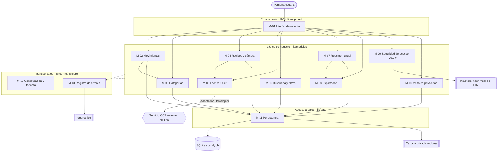
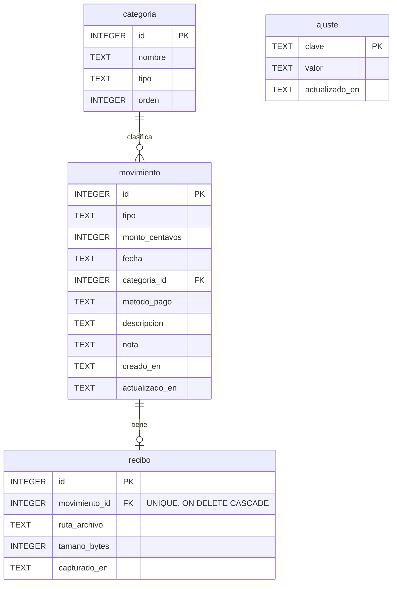

# Arquitectura de SPENDY (RNF-48)

| Dato | Registro |
|---|---|
| Proyecto | SPENDY: app móvil para registrar ingresos, gastos y recibos (Zenorbak 2) |
| Integrantes | Reynoso Nesme Hugo Damián (Operador de IA y Documentador) · Gutiérrez García Julio Augusto (Analista y Tester) |
| Versión del documento | 1.0 · 17/11/2026 (código en v1.0.0) |
| Fuente | Documento de requerimientos, secciones 12.3 a 12.9 y 13 (`docs/requerimientos.pdf`), revisado contra el código de `lib/` |
| Stack | Flutter 3.47.9 / Dart 3.13.7 · SQLite (`sqflite`) · Android 10 (API 29) o superior |

Este documento describe la arquitectura **tal como está construida**. Donde el
código difiere del diseño original de la sección 12, se dice.

## 1. Vista general: tres capas y dos módulos transversales

La persona solo interactúa con la capa de presentación. La lógica de negocio
vive en servicios independientes que no conocen Flutter (salvo donde se
indica) y el acceso a datos queda encapsulado en repositorios. Con el
proveedor elegido (Google ML Kit, sección 5.2) ningún dato sale del teléfono:
la foto del recibo se lee en el mismo dispositivo, a través de un adaptador
de OCR.



Representación textual (por si el visor no dibuja Mermaid):

```text
Persona → M-01 Interfaz ─┬→ M-02 Movimientos ──→ M-03 Categorías
                         ├→ M-04 Recibos ──────→ M-05 OCR ──[OcrAdapter]──→ Servicio OCR (HTTPS)
                         ├→ M-06 Filtros
                         ├→ M-07 Resumen ──────→ M-08 Exportador ──→ menú Compartir
                         ├→ M-09 PIN (v0.7.0) ─→ Keystore
                         └→ M-10 Aviso
        M-02, M-03, M-04, M-06, M-07, M-10 ──→ M-11 Persistencia ──→ SQLite + recibos/
        Todos ──→ M-12 (límites y formatos) y M-13 (errores.log)
```

### Reglas de dependencia (RNF-30, RNF-31)

| Regla | Cómo se cumple | Cómo se verifica |
|---|---|---|
| Las pantallas no acceden a la base de datos | Ningún archivo de `lib/ui/` importa `lib/data/`. Solo `lib/main.dart` arma los repositorios y los entrega a los servicios. | `python3 tool/check_quality.py` (falla si `lib/ui` importa `lib/data`) |
| Un módulo por carpeta con interfaz definida | Cada carpeta de `lib/modules/` expone un servicio (`MovementService`, `ReceiptService`, `OcrService`, `MovementFilter`, `SummaryService`, `ExportService`, `OnboardingService`, `CategoryCatalog`). Los servicios devuelven `Result<T>` (`Success` o `Failure(AppError)`) en vez de lanzar excepciones. | Revisión de imports y pruebas unitarias por módulo |
| Solo el OCR usa red | `lib/modules/ocr/cloud_ocr_adapter.dart` es el único archivo con `HttpClient`. | `test/integration/offline_test.dart` (RF-52) |
| El cálculo del resumen no depende de la interfaz | `AnnualSummaryCalculator` es Dart puro; CSV y PDF son clases separadas que implementan `SummaryExporter` (RNF-33). | `test/unit/annual_summary_calculator_test.dart`, `csv_exporter_test.dart` |
| Límites en un solo lugar | `lib/config/app_config.dart` y `lib/config/categories.dart` (RNF-26). | `test/unit/config_test.dart` |

## 2. Los 13 módulos

| ID | Módulo | Capa | Carpeta / archivos | RF y RNF | Estado en v1.0.0 |
|---|---|---|---|---|---|
| M-01 | Interfaz de usuario | Presentación | `lib/app.dart`, `lib/ui/screens/` (8 pantallas), `lib/ui/widgets/` | Presentación de todos los RF; RNF-01 a RNF-06, RNF-30, RNF-35 | Completo para v1.0.0; faltan `settings_screen.dart` y `pin_screen.dart` (v0.7.0) |
| M-02 | Gestor de movimientos | Lógica | `lib/modules/movements/` (`movement_service.dart`, `balance_calculator.dart`) | RF-01 a RF-11 | Completo |
| M-03 | Catálogo de categorías | Lógica | `lib/modules/categories/category_catalog.dart` | RF-12 a RF-14 | Completo |
| M-04 | Captura de recibos | Lógica | `lib/modules/receipts/` (`camera_service.dart`, `receipt_service.dart`) | RF-15 a RF-22; RNF-12, RNF-14, RNF-21 | Completo |
| M-05 | Lectura OCR | Lógica | `lib/modules/ocr/` (`ocr_adapter.dart`, `mlkit_ocr_adapter.dart`, `ocr_layout.dart`, `cloud_ocr_adapter.dart`, `mock_ocr_adapter.dart`, `receipt_parser.dart`, `ocr_service.dart`) | RF-23 a RF-31; RNF-13, RNF-16 a RNF-18, RNF-32 | Completo; proveedor: Google ML Kit en el teléfono (sección 5.2) |
| M-06 | Búsqueda y filtros | Lógica | `lib/modules/search/movement_filter.dart` | RF-32 a RF-35; RNF-09 | Completo |
| M-07 | Resumen anual | Lógica | `lib/modules/summary/` | RF-36 a RF-40; RNF-10, RNF-33 | Completo |
| M-08 | Exportador | Lógica | `lib/modules/export/` (`exporter.dart`, `csv_exporter.dart`, `pdf_exporter.dart`, `export_service.dart`) | RF-41 a RF-44; RNF-11, RNF-33, RNF-38 | Completo |
| M-09 | Seguridad de acceso | Lógica | `lib/modules/security/` | RF-45 a RF-50; RNF-15, RNF-19, RNF-22 | **Pendiente: incremento 7 (v0.7.0), posterior al 23/11/2026.** Ver sección 7. |
| M-10 | Aviso de privacidad e inicio | Lógica | `lib/modules/privacy/onboarding_service.dart`, `lib/config/privacy_texts.dart` | RF-51; RNF-51 | Completo |
| M-11 | Persistencia | Datos | `lib/data/` (`database.dart`, `image_store.dart`, `migrations/`, `models/`, `repositories/`) | RF-11, RF-19, RF-52, RF-53; RNF-14, RNF-21, RNF-27 | Completo; falta `secure_store.dart` y el borrado total (v0.7.0) |
| M-12 | Configuración y formato | Transversal | `lib/config/`, `lib/core/formatters.dart`, `lib/core/validators.dart` | RF-54; RNF-26, RNF-37 | Completo |
| M-13 | Registro de errores | Transversal | `lib/core/result.dart`, `lib/core/error_logger.dart` | RNF-05, RNF-20, RNF-28 | Completo |

### Responsabilidades, entradas y salidas

| Módulo | Responsabilidad | Entradas | Salidas |
|---|---|---|---|
| M-01 | Mostrar pantallas (inicio con balance, lista con filtros, formulario, detalle, escaneo, revisión OCR, resumen, aviso) y traducir toques en llamadas a servicios. | Toques y datos capturados; resultados de los servicios. | Pantallas actualizadas; mensajes no técnicos. |
| M-02 | Validar, crear, editar, eliminar y listar movimientos; balance del mes. | Borrador del formulario (`MovementDraft`); id. | Movimiento guardado o errores por campo; lista ordenada; `MonthlyBalance`. |
| M-03 | Dar las categorías válidas para cada tipo y validar que coincidan. | Tipo de movimiento. | Lista de categorías. |
| M-04 | Permiso de cámara, captura, compresión a ≤ 1.5 MB, temporal, vincular, reemplazar, quitar y limpiar huérfanos. | Foto, estado del permiso, espacio libre, id del egreso. | Recibo temporal o guardado; error de permiso, cámara ocupada o sin espacio. |
| M-05 | Enviar la foto al OCR por el adaptador con límite de 10 s y cancelación; interpretar comercio, fecha y total. | Imagen; orden de cancelar. | `OcrRead` con campos validados (vacíos si no se leyeron), `OcrIllegible`, `OcrFailed` (sin conexión, tiempo agotado, no disponible) u `OcrCancelled`. |
| M-06 | Filtros combinados (fechas, categoría, tipo, texto sin acentos) con conteo y suma. | `MovementCriteria`. | `FilterResult` o "sin resultados". |
| M-07 | Años con movimientos; totales del año y gastos por categoría, en centavos. | Año. | `AnnualSummary` o año sin movimientos. |
| M-08 | Generar CSV (UTF-8 con BOM) o PDF, nombrarlo `spendy_resumen_AAAA` y entregarlo al menú de compartir. | `AnnualSummary`, formato. | Archivo compartido o error sin archivos parciales. |
| M-10 | Mostrar el aviso en el primer inicio y guardar la aceptación. | Bandera en `ajuste`. | Aviso aceptado. |
| M-11 | Migraciones, repositorios, guardado atómico egreso + recibo, imágenes privadas. | Entidades y criterios. | Entidades guardadas o error de almacenamiento. |
| M-12 | Límites, categorías, textos y formatos `$1,234.56` y `DD/MM/AAAA`. | Valores sin formato. | Texto con formato; límites. |
| M-13 | Traducir errores a mensajes para la persona y registrarlos sin datos sensibles. | Error (tipo, módulo, causa). | Línea en `errores.log`; `AppError` con mensaje. |

### Flujos principales

| Flujo | Recorrido |
|---|---|
| Registrar | M-01 formulario → M-02 valida con M-12 y M-03 → M-11 inserta → M-01 lista y balance |
| Escanear recibo | M-01 escanear → M-04 permiso, foto y compresión a temporal → M-05 `OcrService` → `OcrAdapter` → servicio externo → M-01 pantalla de revisión → M-02 valida → M-11 guarda movimiento y recibo en una transacción → lista y balance |
| Resumen y exportación | M-01 resumen → M-07 calcula desde M-11 → M-08 CSV o PDF → menú Compartir del sistema |
| Cualquier error | servicio → M-13 registra en `errores.log` → `Failure(AppError)` → M-01 muestra el mensaje y "Reintentar" |

## 3. Modelo de datos (SQLite)

Base `spendy.db` en el almacenamiento privado de la app, con llaves foráneas
activas y esquema versionado (versión 1 = `lib/data/migrations/v1_initial.dart`,
RNF-27). La migración corre dentro de una transacción: si falla, la base
queda vacía y no a medias.



```text
categoria (1) ──────< (N) movimiento (1) ──────o (0..1) recibo
ajuste (independiente)
```

### Diccionario de datos

| Tabla | Campo | Tipo | Obligatorio | Descripción | Ejemplo |
|---|---|---|---|---|---|
| categoria | id | INTEGER PK | Sí | Ids estables: egreso 1 a 6, ingreso 7 y 8 | 1 |
| categoria | nombre | TEXT | Sí | Nombre visible (catálogo fijo de `categories.dart`, RF-12, RF-13) | Alimentos |
| categoria | tipo | TEXT | Sí | `ingreso` o `egreso` (RF-14) | egreso |
| categoria | orden | INTEGER | Sí | Posición en la lista | 1 |
| movimiento | id | INTEGER PK AUTOINCREMENT | Sí | Identificador | 125 |
| movimiento | tipo | TEXT | Sí | `ingreso` o `egreso` | egreso |
| movimiento | monto_centavos | INTEGER | Sí | Monto en centavos, 1 a 999,999,999 (RF-04) | 35000 (= $350.00) |
| movimiento | fecha | TEXT | Sí | `AAAA-MM-DD`, sin hora, no futura (RF-03, TEC-09) | 2026-10-15 |
| movimiento | categoria_id | INTEGER FK | Sí | → `categoria.id`; su tipo coincide con el del movimiento | 1 |
| movimiento | metodo_pago | TEXT | Solo egresos | `efectivo`, `debito`, `credito` o `transferencia` | efectivo |
| movimiento | descripcion | TEXT | No | Comercio o descripción, máximo 60 caracteres | Tienda La Esquina |
| movimiento | nota | TEXT | No | Nota libre, máximo 200 caracteres | Comida del lunes |
| movimiento | creado_en | TEXT | Sí | ISO 8601; desempata el orden de la lista | 2026-10-15T13:20:05 |
| movimiento | actualizado_en | TEXT | Sí | ISO 8601 de la última edición (RF-08) | 2026-10-15T13:25:41 |
| recibo | id | INTEGER PK AUTOINCREMENT | Sí | Identificador | 58 |
| recibo | movimiento_id | INTEGER FK UNIQUE | Sí | → `movimiento.id`, borrado en cascada (RF-09) | 125 |
| recibo | ruta_archivo | TEXT | Sí | Ruta dentro de la carpeta privada | recibos/7f3a9c.jpg |
| recibo | tamano_bytes | INTEGER | Sí | Tamaño ya comprimido, ≤ 1,572,864 (RNF-12) | 842113 |
| recibo | capturado_en | TEXT | Sí | Fecha y hora de la foto | 2026-10-15T13:19:50 |
| ajuste | clave | TEXT PK | Sí | Nombre del ajuste | aviso_privacidad_aceptado |
| ajuste | valor | TEXT | Sí | Valor | true |
| ajuste | actualizado_en | TEXT | Sí | Último cambio | 2026-10-15T09:02:11 |

### Índices (RNF-09, RNF-10)

| Índice | Columnas | Para qué |
|---|---|---|
| `idx_movimiento_fecha` | `movimiento(fecha)` | Lista ordenada, balance del mes, filtro por rango |
| `idx_movimiento_categoria` | `movimiento(categoria_id)` | Filtro por categoría y gastos por categoría |
| `idx_movimiento_tipo_fecha` | `movimiento(tipo, fecha)` | Filtro por tipo y totales del año |

Con 2,000 movimientos la lista carga en 62 ms, los filtros en 5 a 48 ms y el
resumen en 41 ms (medido en el equipo de desarrollo; ver
`docs/plan_pruebas.md`, sección 5).

### Almacenamiento fuera de la base

| Qué | Dónde | Reglas |
|---|---|---|
| Imágenes de recibos | `getApplicationSupportDirectory()/recibos/` y `temp_recibos/` (capturas aún sin guardar), cada carpeta con `.nomedia` | Privadas de la app, nunca en la galería (RNF-14). JPEG con lado mayor ≤ 2400 px y ≤ 1.5 MB (RNF-12). La base guarda solo la ruta. |
| Guardado atómico egreso + recibo | `MovementRepository.insertWithReceipt` | La foto se escribe primero en `temp_recibos/`. El movimiento y la fila de recibo se insertan en una sola transacción y, dentro de ella, el archivo pasa a `recibos/`; si algo falla, la transacción se revierte y se borran el temporal y el destino. Al arrancar, `ReceiptService.cleanOrphans()` borra temporales y archivos sin fila (TEC-06, RNF-21). |
| PIN | Almacén seguro del sistema (Android Keystore) | Hash con sal, intentos fallidos y bloqueo hasta; nunca en SQLite ni en texto plano (RNF-15, RNF-22). **Llega con v0.7.0** (sección 7). |
| Bitácora | `getApplicationSupportDirectory()/errores.log` | Una línea por error: `fecha UTC | tipo | módulo | clase de la excepción`. Nunca guarda el mensaje de la excepción, montos, comercios, notas, rutas ni PIN (RNF-20). |
| Archivos exportados | Carpeta temporal del sistema | Se crean solo cuando la generación terminó; si falla no quedan parciales (RF-44). |

## 4. Configuración, formato y errores

- `AppConfig` (`lib/config/app_config.dart`) concentra monto máximo, longitudes,
  tamaño de imagen, calidades JPEG, margen de espacio libre y tiempos del OCR
  (10 s límite, 8 s meta). Las constantes del PIN (longitud 6, 5 intentos,
  30 s de bloqueo, 60 s en segundo plano) se agregan aquí en v0.7.0 (RNF-26).
- Formatos fijos en español de México (`lib/core/formatters.dart`):
  `$1,234.56` y `DD/MM/AAAA`, sin depender del idioma del teléfono. La app fija
  `Locale('es', 'MX')` en `MaterialApp` (RNF-37, CA-152).
- Mensajes de error en `ErrorMessages` (`lib/core/error_logger.dart`): causa y
  siguiente acción, sin códigos ni trazas (RNF-04, RNF-05).

## 5. Servicio de OCR: patrón Adaptador, clave y privacidad

### 5.1 Patrón Adaptador (RNF-32)

```text
OcrService (M-05)  ──usa──▶  OcrAdapter (interfaz: read(bytes) → texto)
                                 ├─ MlKitOcrAdapter        Google ML Kit en el teléfono (proveedor elegido)
                                 ├─ CloudOcrAdapter        HTTPS + Bearer, contrato del README (alternativa)
                                 ├─ MockOcrAdapter         pruebas y demo sin red
                                 └─ UnconfiguredOcrAdapter sin configuración: avisa y deja registrar a mano
```

`OcrService` agrega lo que no depende del proveedor: límite de 10 s, cancelación,
traducción de errores y el intérprete `receipt_parser.dart` (comercio, fecha y
total). Cambiar de proveedor es escribir otra clase que implemente
`OcrAdapter` y elegirla en `main.dart`; no se tocan pantallas ni lógica. Las
pruebas del flujo completo de escaneo usan `MockOcrAdapter`
(`test/integration/scan_flow_test.dart`).

### 5.2 Proveedor elegido: Google ML Kit Text Recognition

**Decisión (17/11/2026, TEC-01 y TEC-02 resueltos):** la lectura se hace en el
teléfono con Google ML Kit Text Recognition v2 (modelo de texto latino incluido
en el APK, paquete `google_mlkit_text_recognition`). Lo implementa
`MlKitOcrAdapter` y `main.dart` lo elige en Android e iOS cuando no hay un
servicio en la nube configurado.

Cómo cumple los criterios de selección:

| Criterio | Por qué | Requerimiento | ML Kit en el teléfono |
|---|---|---|---|
| No retiene ni usa las imágenes para entrenar | Los recibos tienen datos personales | TEC-02, RNF-17, RNF-51 | Cumple: la imagen no sale del teléfono |
| HTTPS con TLS 1.2 o superior | Nada viaja sin cifrar | RNF-16 | No aplica: no hay transmisión |
| Precisión ≥ 80 % en el total con 30 recibos mexicanos reales | Meta de aceptación | RNF-42 | Por medir con la prueba de `docs/plan_pruebas.md` |
| Respuesta ≤ 8 s en el 90 % de los intentos | Meta de tiempo | RNF-13 | Se espera cumplir: lectura local de 1 a 2 s en un teléfono medio, sin red |
| Clave restringible o uso a través de un proxy | Una clave en el APK se puede extraer | TEC-01, RNF-18 | Cumple: no hay clave |
| Costo dentro del plan gratuito | Proyecto académico | Sección 3 | Cumple: gratuito y sin cuota |

Otras ventajas: funciona sin internet (uso sin conexión de M-06) y no hay
servicio que contratar ni mantener. Costos aceptados: el APK crece unos 4 MB
por arquitectura por el modelo, y la precisión depende de la foto (luz,
enfoque, ticket completo).

Cómo se arma el texto: ML Kit entrega el texto por bloques y, en un ticket, la
columna de conceptos ("TOTAL") y la de importes ("$39.50") salen en bloques
distintos. `ocr_layout.dart` vuelve a juntar los renglones por su posición en
la foto antes de pasar el texto a `receipt_parser.dart`, que además corrige
dos errores típicos del OCR: la letra O leída como cero ("T0TAL", "1O0.00") y
espacios alrededor del punto decimal. Pruebas: `test/unit/mlkit_ocr_test.dart`.

`CloudOcrAdapter` se conserva como alternativa (RNF-32): si se compila con
`SPENDY_OCR_ENDPOINT` y `SPENDY_OCR_API_KEY`, se usa el servicio en la nube y
el aviso de privacidad cambia al texto que nombra al proveedor.

### 5.3 Manejo de la clave (TEC-01, RNF-18)

Con ML Kit no hay clave. Lo siguiente aplica solo si se usa la alternativa en
la nube.

- La clave no está en el código ni en el historial de Git (revisado al cierre,
  ver `docs/plan_pruebas.md`, sección 3). Se pasa al compilar con
  `--dart-define-from-file=.env`; `.env` y `ocr.env.json` están en `.gitignore`
  y solo se versiona `.env.example`, sin valores.
- Riesgo aceptado para el MVP: un valor de `--dart-define` queda dentro del
  APK y se puede extraer. Mitigación recomendada para después: un proxy mínimo
  propio que guarde la clave del lado del servidor, o una clave restringida
  con cuota baja.

### 5.4 Privacidad de las imágenes (TEC-02, RNF-17)

- Con ML Kit la foto se escribe un momento en la carpeta privada
  (`temp_recibos/`), se lee en el teléfono y el archivo se borra; no se envía.
  El aviso de privacidad (M-10) lo dice así.
- Con la alternativa en la nube, solo se envían los bytes de la foto
  comprimida (`Content-Type: image/jpeg`), nunca montos, notas, categorías ni
  PIN, y el aviso nombra al proveedor con `SPENDY_OCR_PROVIDER_NAME`.
- Las fotos se quedan en la carpeta privada; no se suben a ningún otro lugar.

## 6. Decisiones de diseño y sus razones

| Decisión | Razón | Alternativa descartada |
|---|---|---|
| Flutter con Android como plataforma probada (ALC-01) | Una sola base de código; el equipo prueba en Android. iOS queda para otra fase. | Nativo Android/iOS: doble esfuerzo |
| SQLite local (`sqflite`) | Datos relacionales, consultas por fecha y categoría rápidas, sin servidor | Archivos JSON: sin consultas ni transacciones |
| Montos en centavos (`INTEGER`) | Sin errores de redondeo | `REAL` |
| `Result<T>` en vez de excepciones hacia la interfaz | Ningún error esperado cierra la app (RNF-28) | Excepciones sin capturar |
| Adaptador de OCR | Cambiar o simular el proveedor sin tocar el resto (RNF-32) | Llamar al proveedor desde la pantalla |
| Imágenes fuera de la base | La base se mantiene pequeña y rápida | BLOB en SQLite |

## 7. Seguridad de acceso con PIN (M-09) · se completa con v0.7.0

> **Pendiente.** El incremento 7 (RF-45 a RF-50) es *Should* y se implementa
> después de la entrega del 23/11/2026 (regla de recorte 3.3, GRA-04). Esta
> sección deja el diseño acordado en la orden del incremento 7 para que se
> confirme contra el código cuando llegue `v0.7.0`.

| Componente | Archivo previsto | Responsabilidad |
|---|---|---|
| SecureStore | `lib/data/secure_store.dart` | Guardar en Android Keystore el hash del PIN, la sal aleatoria, `failed_attempts` y `lockout_until`. Activación atómica solo tras la segunda captura (CA-117). |
| PinService | `lib/modules/security/pin_service.dart` | Formato de 6 dígitos, activar con doble captura, verificar, 5 intentos y bloqueo de 30 s que sobrevive al cierre (RNF-22), cambiar y desactivar. |
| BiometricService | `lib/modules/security/biometric_service.dart` | Detectar huella o rostro; si falla o cambian las huellas, pedir el PIN. |
| LockController | `lib/modules/security/lock_controller.dart` | Bloquear al abrir en frío y al volver tras más de 60 s en segundo plano; ocultar contenido en apps recientes (RNF-19). |
| Restablecimiento total | `database.dart`, `image_store.dart` | Borrar base, `recibos/` y claves con bandera de estado para no quedar a medias (RF-50, CA-139). |
| Pantallas | `lib/ui/screens/settings_screen.dart`, `pin_screen.dart` | Gestión del PIN y desbloqueo; "Olvidé mi PIN" con doble confirmación. |

_[Completar con v0.7.0: archivos reales, decisiones tomadas (algoritmo de hash,
paquete del almacén seguro, cómo se oculta en recientes) y resultados de
pruebas.]_
