# Manual de usuario de SPENDY

Versión 1.1 · 19 de noviembre de 2026 · Zenorbak 2

SPENDY te ayuda a anotar lo que ganas y lo que gastas, guardar la foto de tus
recibos, poner un límite de gasto por categoría y saber cómo vas en el mes.
No necesitas saber de contabilidad: solo anotas cuánto, cuándo y en qué.

Todo lo que registras se queda **solo en tu teléfono**. SPENDY no tiene
cuentas ni servidores. Lo único que sale del teléfono es la foto de un recibo
cuando lo escaneas, para que Gemini de Google lo lea (sección 6).

> Las imágenes de este manual se tomaron de la app con datos de ejemplo. En
> tu teléfono los colores y tamaños pueden variar un poco.

## Contenido

1. Primer inicio: el aviso de privacidad
2. Cómo se mueve uno en la app
3. La pantalla de Inicio
4. Registrar un gasto o un ingreso
5. Ver, corregir o eliminar un movimiento
6. Escanear un recibo (lectura con Gemini)
7. Buscar y filtrar movimientos
8. Resumen del año y exportarlo
9. Presupuestos por categoría
10. "Tu mes": cómo vas contra el mes pasado
11. Proteger la app con PIN y huella
12. Copia de seguridad
13. Si algo sale mal

Palabras que vas a ver:

| Palabra | Qué quiere decir |
|---|---|
| Egreso | Dinero que sale: un gasto. |
| Ingreso | Dinero que entra: tu sueldo, una venta, un regalo. |
| Movimiento | Cualquier egreso o ingreso que anotas. |
| Balance | Lo que entró menos lo que salió en el mes. |
| Presupuesto | El máximo que quieres gastar al mes en una categoría. |
| OCR | La lectura automática del recibo: la app "lee" la foto y llena los datos por ti. |

## 1. Primer inicio: el aviso de privacidad

La primera vez que abres SPENDY aparece el **Aviso de privacidad**. Explica
qué datos guarda la app, que todo se queda en el teléfono y que la foto de
cada recibo que escanees se envía cifrada a Google (Gemini) para leerla.

1. Lee el aviso completo (desliza hacia arriba).
2. Toca **Acepto**.

Sin aceptarlo no se puede usar la app. Si el aviso cambia en una versión
nueva, la app te lo vuelve a mostrar. Puedes leerlo cuando quieras en
**Ajustes › Aviso de privacidad**.

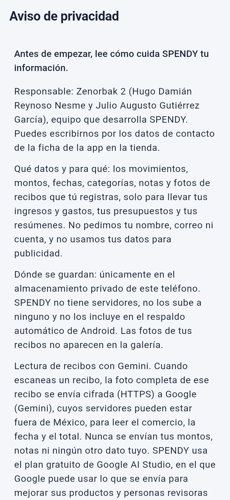

## 2. Cómo se mueve uno en la app

Abajo siempre está la barra con cinco botones:

| Botón | Para qué sirve |
|---|---|
| **Inicio** | Tu balance del mes, accesos rápidos, "Tu mes", presupuestos y movimientos recientes. |
| **Movimientos** | La lista completa, con búsqueda y filtros. |
| **Escanear** (el círculo del centro) | Abre la cámara para leer un recibo. |
| **Resumen** | Los totales del año y la gráfica de gastos por categoría. |
| **Ajustes** | PIN, huella, presupuestos, copia de seguridad y aviso de privacidad. |

En **Inicio** y **Movimientos** también está el botón **+ Registrar**, abajo
a la derecha, para anotar un movimiento a mano.

## 3. La pantalla de Inicio

De arriba hacia abajo verás:

- La fecha de hoy y un saludo.
- La tarjeta azul con el **Balance** del mes en curso (ingresos menos
  egresos) y, debajo, cuánto entró y cuánto salió. Toca el **ojo** para
  ocultar los montos si alguien está viendo tu pantalla; tócalo otra vez para
  mostrarlos.
- Tres accesos rápidos: **Ingreso**, **Egreso** y **Escanear**.
- La tarjeta **Tu mes** (sección 10).
- La tarjeta **Presupuestos** del mes (sección 9).
- **Movimientos recientes**, con la misma búsqueda y filtros de la pestaña
  Movimientos.

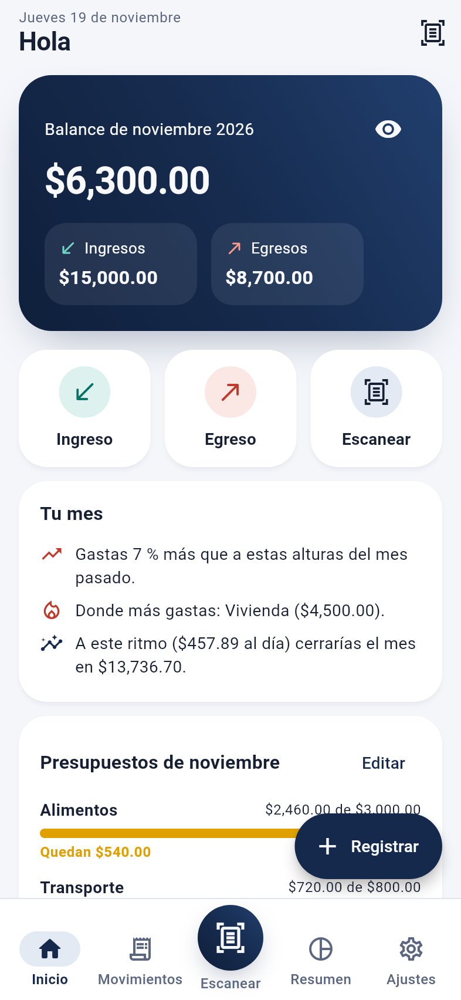 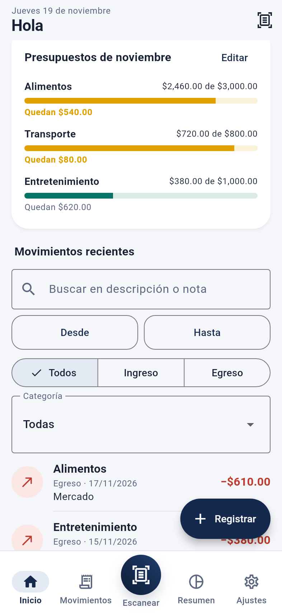

Los montos se ven siempre como `$1,234.56` y las fechas como `DD/MM/AAAA`,
aunque tu teléfono esté en otro idioma.

## 4. Registrar un gasto o un ingreso

1. En Inicio toca **Egreso** o **Ingreso** (o **+ Registrar** y elige arriba
   **Egreso** o **Ingreso**).
2. Escribe el **Monto**. Usa punto para los centavos: `350` o `350.50`.
   El máximo es $9,999,999.99.
3. La **Fecha** ya trae el día de hoy. Toca el calendario para cambiarla. No
   se aceptan fechas futuras.
4. Elige la **Categoría**. Gastos: Alimentos, Transporte, Vivienda,
   Servicios, Entretenimiento u Otros. Ingresos: Sueldos y salarios u Otros
   ingresos.
5. Si es un gasto, elige el **Método de pago**: Efectivo, Débito, Crédito o
   Transferencia.
6. Si quieres, escribe una **Descripción o comercio** (hasta 60 letras) y una
   **Nota** (hasta 200). Desde aquí también puedes tocar **Escanear recibo**.
7. Toca **Guardar**.

Los campos con `*` son obligatorios. Si falta alguno o el monto no es válido,
la app marca el campo en rojo y te dice qué corregir; lo que ya escribiste no
se borra.

Si el gasto te acerca a tu presupuesto de esa categoría (80 % o más) o te
pasas, al guardar aparece un aviso abajo, por ejemplo "Ya usaste el 94 % del
presupuesto de Alimentos".

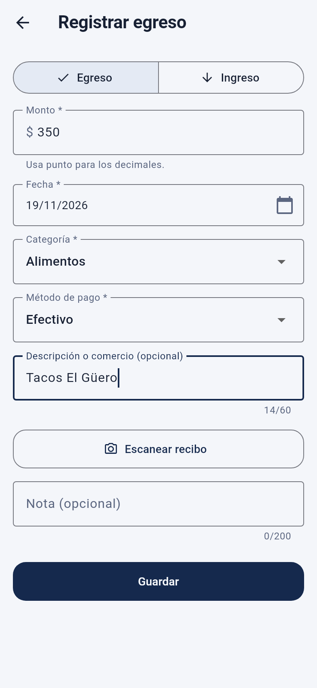

## 5. Ver, corregir o eliminar un movimiento

La pestaña **Movimientos** muestra todos, del más reciente al más antiguo.
Los ingresos llevan una flecha verde y signo `+`; los egresos, una flecha
roja y signo `−`. Si tienes muchos, se van cargando al bajar.

1. Toca un movimiento. Se abre el **Detalle del movimiento**.
2. Para corregirlo, toca **Editar**, cambia lo que necesites y toca
   **Guardar**. El balance se actualiza solo.
3. Para borrarlo, toca **Eliminar**. La app te pide confirmar:
   - **Eliminar** lo borra junto con la foto de su recibo, si tiene.
   - **Cancelar** no cambia nada.

Eliminar no se puede deshacer.

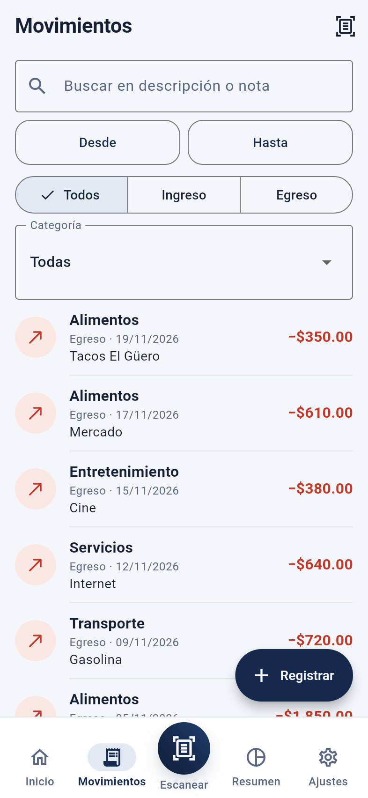 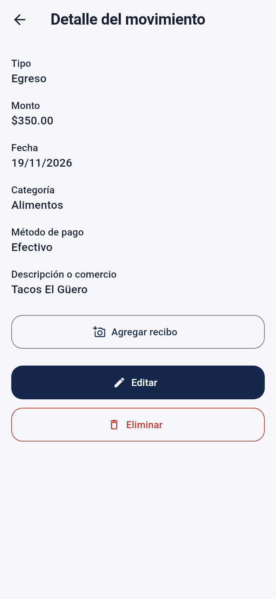 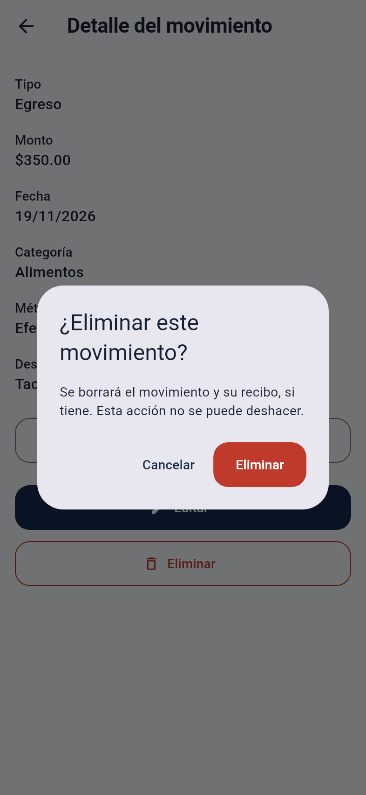

En el detalle de un gasto también puedes **Agregar recibo**, verlo en grande
(toca la miniatura y usa dos dedos para acercar), **Reemplazar** la foto o
**Quitar recibo**.

## 6. Escanear un recibo (lectura con Gemini)

Con esta función no tienes que escribir el total, la fecha ni el comercio: la
app los lee de la foto con Gemini, la inteligencia artificial de Google. **No
tienes que configurar nada ni capturar ninguna clave**: ya viene lista en la
app. Necesitas internet.

1. Toca **Escanear** (el círculo del centro de la barra o el acceso rápido de
   Inicio).
2. La primera vez, el teléfono te pide permiso para usar la cámara. Toca
   **Permitir**. Si lo niegas, puedes registrar a mano; la app te ofrece
   **Abrir Ajustes** para activarlo después.
3. Pon el recibo completo sobre una superficie plana, con buena luz, y toca
   **Tomar foto**.
4. Revisa la foto. Si salió borrosa toca **Repetir**; si se ve bien, toca
   **Usar foto**.
5. Aparece **Leyendo el recibo…** Normalmente tarda unos 10 segundos y
   **puede tardar hasta 45**. Espera sin salir de la pantalla; si no quieres
   esperar, toca **Cancelar**.
6. Se abre **Revisar recibo** con el monto, la fecha y el comercio ya
   escritos y la foto adjunta. **Revísalos**: la lectura puede equivocarse.
   Lo que no se pudo leer queda vacío y marcado ("No se pudo leer;
   escríbelo"). Si la fecha no se pudo leer o era futura, se pone la de hoy.
7. Elige la **Categoría** y el **Método de pago** y toca **Guardar**. Nada se
   guarda hasta que tú lo confirmas.

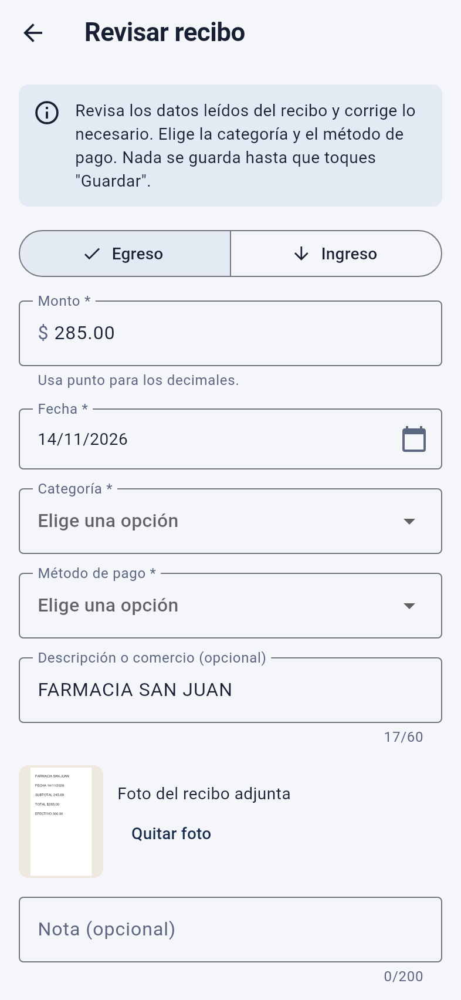

Si no hay internet, el servicio no responde o la lectura pasa de 45
segundos, aparece **No se pudo leer el recibo** con dos opciones:
**Reintentar** o **Registrar manualmente**. Si eliges registrar a mano, se
abre el formulario con la foto ya adjunta: la foto no se pierde. Si la foto no
se entiende, la app te ofrece **Repetir foto**.

**Tu privacidad:** solo se envía la foto del recibo, cifrada, a Google
(Gemini). Nunca se envían tus montos, notas ni otros movimientos. SPENDY usa
el plan gratuito de Google, en el que Google puede usar lo enviado para
mejorar sus productos. Si un recibo trae datos que no quieres compartir (tu
RFC o tu domicilio, por ejemplo), regístralo a mano.

Las fotos de tus recibos se guardan dentro de la app y **no aparecen en tu
galería**.

## 7. Buscar y filtrar movimientos

En **Movimientos** (y en Movimientos recientes de Inicio), arriba de la lista:

| Para | Haz esto |
|---|---|
| Buscar por texto | Escribe en **Buscar en descripción o nota**. No importan acentos ni mayúsculas: "super" encuentra "Súper". |
| Ver un periodo | Toca **Desde** y **Hasta** y elige las fechas. |
| Ver solo gastos o ingresos | Toca **Egreso** o **Ingreso** (o **Todos**). |
| Ver una categoría | Elige una en **Categoría**. |

Puedes combinar varios filtros. Arriba de la lista verás cuántos resultados
hay y cuánto suman. Toca **Limpiar filtros** para volver a ver todo. Si nada
coincide, aparece "Sin resultados".

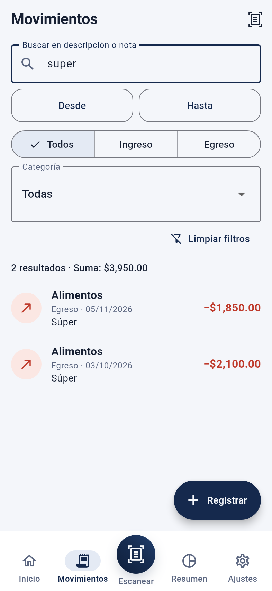

## 8. Resumen del año y exportarlo

1. Toca **Resumen** en la barra de abajo.
2. Aparece el año actual. Para ver otro, elígelo en **Año** (solo salen años
   con movimientos).
3. Verás los **Ingresos del año**, los **Egresos del año**, la **Diferencia**
   y la gráfica de **Gastos por categoría** con el total de cada una.
4. Para guardarlo o enviarlo, baja y toca **Exportar CSV** (se abre en Excel
   o Google Sheets) o **Exportar PDF**. Se abre el menú de compartir de tu
   teléfono: elige WhatsApp, correo, Drive o "Guardar en archivos".

El archivo se llama `spendy_resumen_2026.csv` o `.pdf` (con el año que
elegiste).

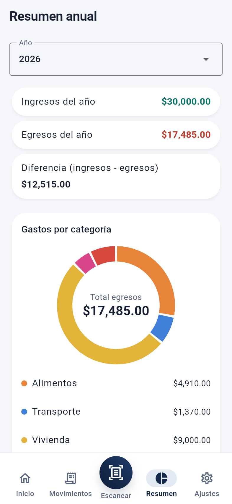

## 9. Presupuestos por categoría

Un presupuesto es el máximo que quieres gastar **al mes** en una categoría.

1. En Inicio, en la tarjeta **Presupuestos**, toca **Crear** (o **Editar**).
   También está en **Ajustes › Presupuestos mensuales**.
2. Escribe el límite de cada categoría que quieras controlar, con punto para
   los centavos. Deja vacío lo que no quieras controlar.
3. Toca **Guardar**.

En Inicio verás una barra por categoría con lo gastado contra el límite y
cuánto te queda: verde mientras vas bien, amarilla desde el 80 % y roja
cuando te pasas ("Te pasaste por $…"). Los presupuestos se reinician cada
mes; los límites se quedan hasta que los cambies.

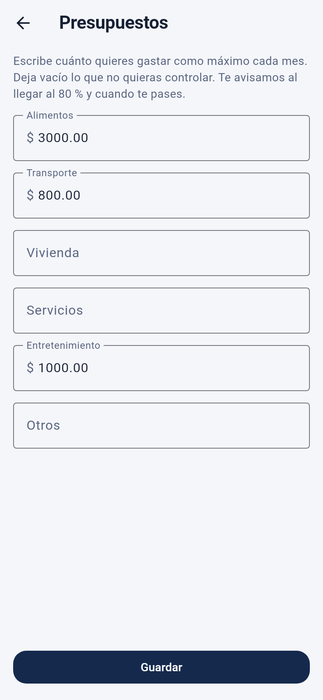 

## 10. "Tu mes": cómo vas contra el mes pasado

La tarjeta **Tu mes** de Inicio te dice, en tres líneas:

- Si gastas más o menos que **a estas alturas** del mes pasado (compara del
  día 1 al día de hoy de cada mes, para que sea justo).
- **Donde más gastas** este mes y cuánto.
- **A este ritmo**: tu gasto promedio por día y cuánto gastarías al cierre del
  mes si sigues igual.

No tienes que hacer nada: se calcula sola con tus movimientos.

## 11. Proteger la app con PIN y huella

**Activar el PIN**

1. Ve a **Ajustes** y, en **Seguridad**, enciende **PIN de acceso**.
2. Escribe un PIN de 6 números. Al escribir el sexto número pasa solo al
   siguiente paso.
3. Escríbelo otra vez para confirmarlo. Si no coinciden, la app te lo vuelve
   a pedir.

Desde ese momento SPENDY pide el PIN **al abrirla** y **al volver a ella
después de más de 1 minuto** en otra app. Además, en la lista de apps
recientes su contenido se ve en blanco y no se pueden tomar capturas de
pantalla dentro de la app.

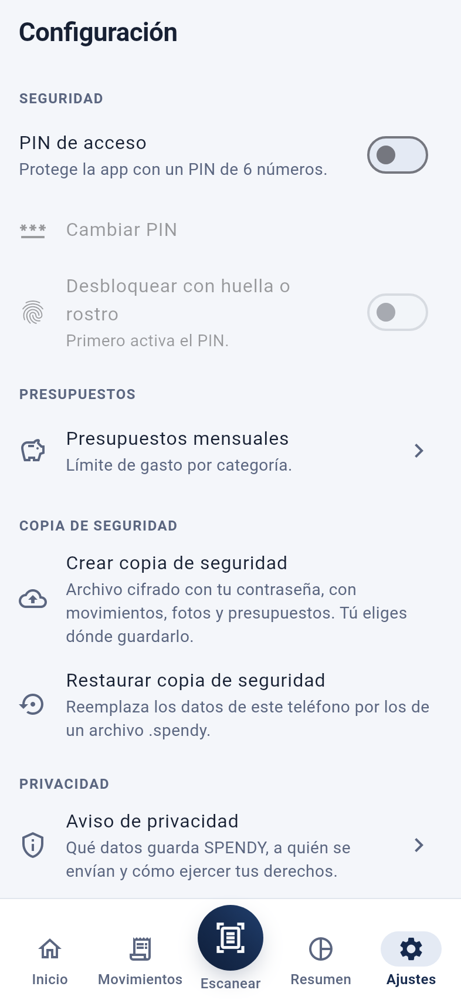 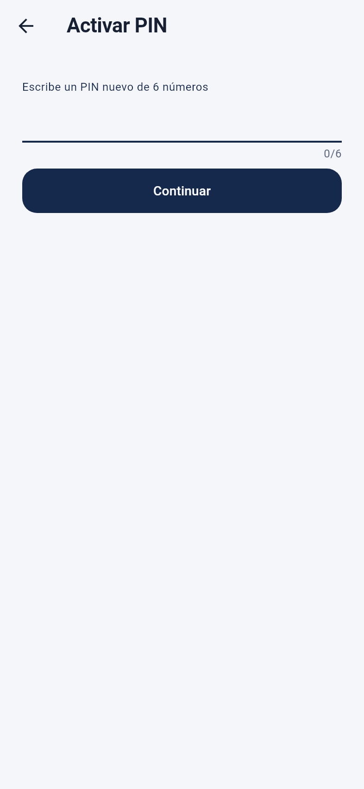

**Huella o rostro**

1. Con el PIN ya activo, enciende **Desbloquear con huella o rostro**.
2. El teléfono te pide confirmar tu huella o rostro.

Al abrir la app toca **Usar huella o rostro**. El PIN sigue funcionando como
respaldo. Si alguien agrega o cambia huellas en el teléfono, SPENDY te pide
el PIN y desactiva la huella; puedes volver a activarla después.

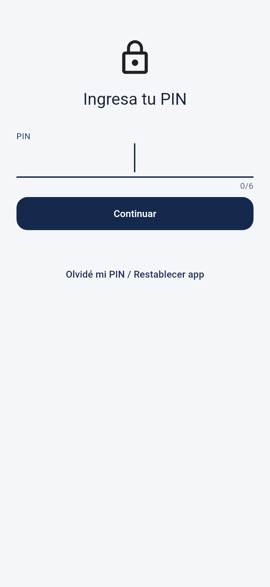

**Cambiar o quitar el PIN**

- **Cambiar PIN**: escribe el PIN actual y luego el nuevo dos veces.
- Para quitarlo, apaga **PIN de acceso** y escribe tu PIN actual.

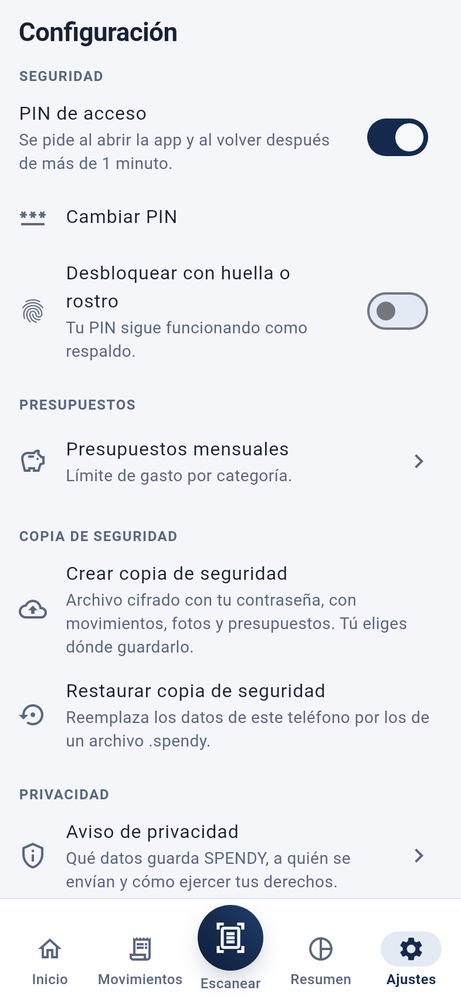

**Si te equivocas de PIN**

Después de 5 intentos fallidos seguidos tienes que esperar 30 segundos. Si
sigues fallando, la espera crece: 1 minuto, 5 minutos, 15 minutos y luego 1
hora. La pantalla te muestra cuánto falta.

**Si olvidaste el PIN**

En la pantalla del PIN toca **Olvidé mi PIN / Restablecer app**. La app te
pide confirmar dos veces (**Continuar** y luego **Borrar todo**) y **borra
todos tus movimientos, recibos y ajustes** del teléfono para que empieces de
nuevo. Si tienes una copia de seguridad, después puedes restaurarla
(sección 12).

## 12. Copia de seguridad

SPENDY no sube tus datos a ninguna nube y no se incluye en el respaldo
automático de Android. Si cambias de teléfono, o lo pierdes, solo te salva
una copia que tú hayas hecho.

**Crear una copia**

1. Ve a **Ajustes › Crear copia de seguridad**.
2. Escribe una contraseña de al menos 8 caracteres y repítela. Toca
   **Continuar**.
3. Elige dónde guardar el archivo (Google Drive, correo, WhatsApp o "Guardar
   en archivos").

La copia es un archivo `.spendy` con tus movimientos, fotos de recibos y
presupuestos, cifrado con tu contraseña.

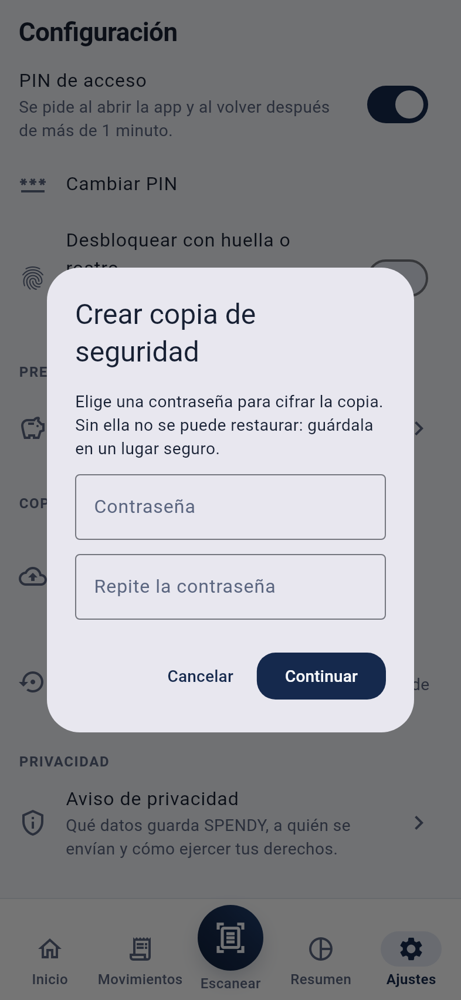

**Restaurar una copia**

1. En el teléfono nuevo ve a **Ajustes › Restaurar copia de seguridad**.
2. La app te avisa que **todo lo que haya en ese teléfono se reemplaza** por
   lo de la copia. Toca **Elegir archivo** y elige el archivo `.spendy`.
3. Escribe la contraseña de la copia.

Al terminar verás cuántos movimientos, recibos y presupuestos se
restauraron. Si la contraseña no es correcta, el archivo no es de SPENDY o
está dañado, la app te lo dice y tus datos actuales no cambian.

> Si olvidas la contraseña de la copia, no hay forma de abrirla. Guárdala en
> un lugar seguro.

## 13. Si algo sale mal

| Mensaje o problema | Qué hacer |
|---|---|
| "No se pudo guardar porque el teléfono no tiene espacio libre." | Borra fotos o apps que no uses y toca **Reintentar**. Lo que escribiste sigue ahí. |
| "No se pudo guardar el movimiento…" | Toca **Reintentar**. Si se repite, cierra y abre la app. |
| "No se pudo cargar la lista" o "No se pudieron cargar tus datos." | Toca **Reintentar**; si sigue, cierra y vuelve a abrir la app o reinicia el teléfono. |
| La cámara no abre o dice que está ocupada | Cierra otras apps que usen la cámara y toca **Reintentar**, o registra a mano. |
| Negaste el permiso de cámara | Toca **Abrir Ajustes** en la app, o ve a Ajustes del teléfono › Apps › SPENDY › Permisos › Cámara › Permitir. |
| "No hay conexión a internet para leer el recibo." | Revisa tu conexión y toca **Reintentar**, o **Registrar manualmente**; la foto se conserva. Todo lo demás funciona sin internet. |
| "La lectura del recibo tardó demasiado." | Pasaron 45 segundos sin respuesta. Toca **Reintentar** o registra a mano; la foto se conserva. |
| "No se pudo leer el recibo. Toma la foto de nuevo…" | Toca **Repetir foto** con buena luz y el recibo completo, o registra a mano con esa foto. |
| La lectura del recibo trajo un dato mal | Corrígelo en **Revisar recibo** antes de **Guardar**. |
| "Los dos PIN no coinciden." | Escribe el PIN nuevo otra vez, igual las dos veces. |
| "No te reconocimos. Ingresa tu PIN." | Escribe tu PIN de 6 números. |
| "La contraseña no es correcta." (copia) | Escríbela de nuevo; distingue mayúsculas y minúsculas. |
| "Esta copia se hizo con una versión más nueva de SPENDY." | Actualiza la app y vuelve a intentar. |

**Importante:** si desinstalas la app, se borran todos tus datos del
teléfono. Haz una copia de seguridad (sección 12) antes de cambiar de
teléfono o desinstalar.
