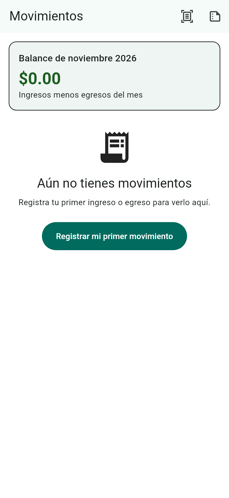
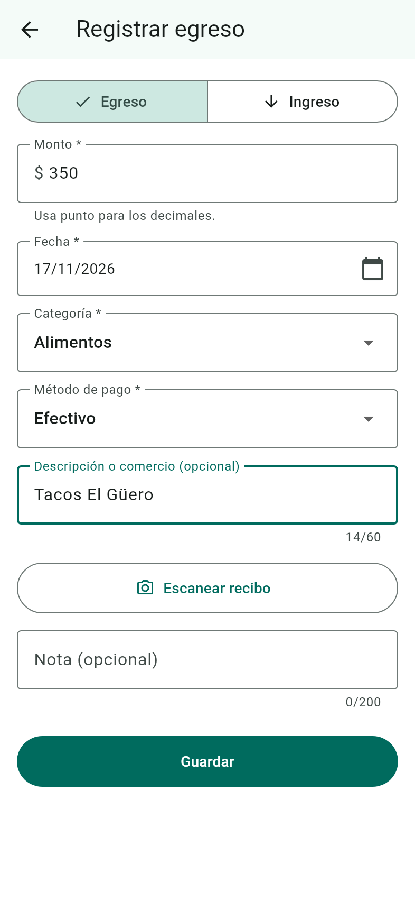
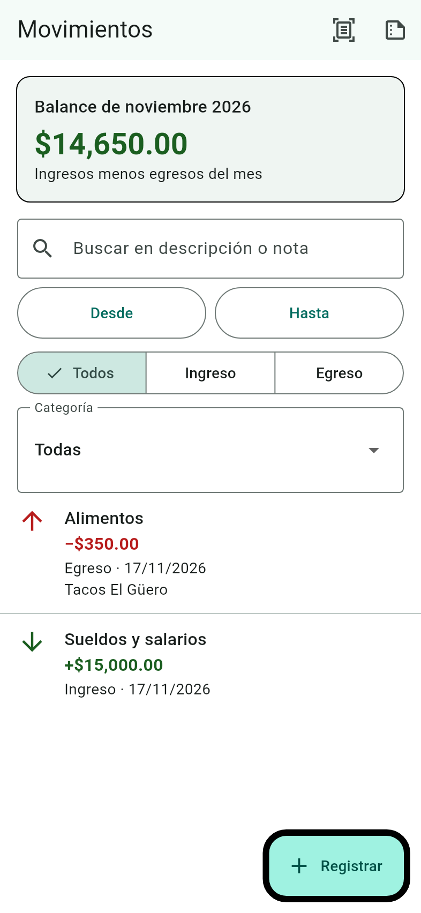
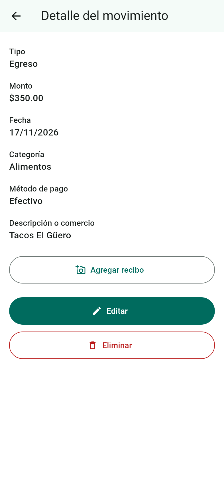
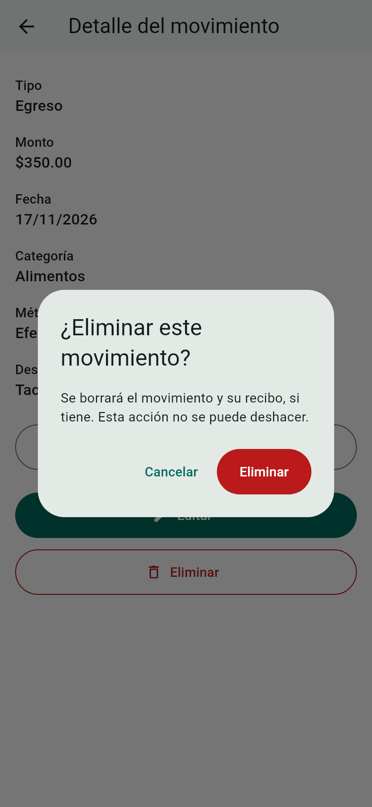
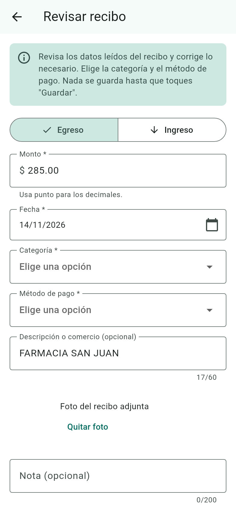
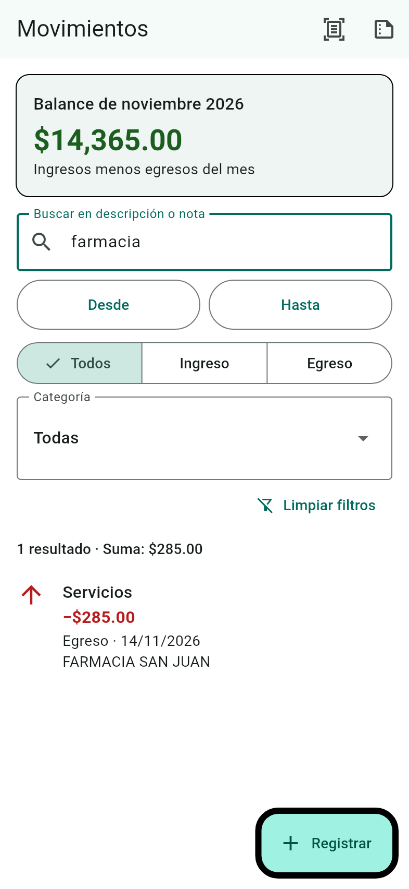
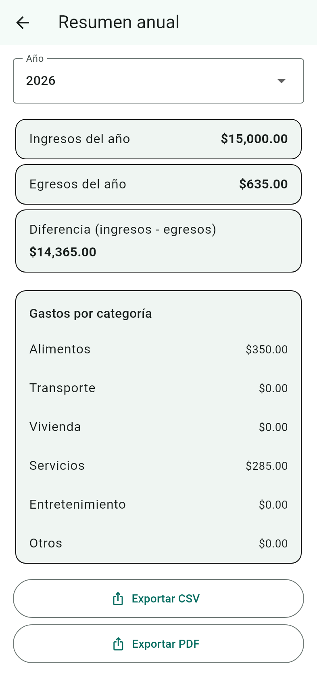

# Manual de usuario de SPENDY

Versión 1.0 · noviembre de 2026 · Zenorbak 2

SPENDY te ayuda a anotar lo que ganas y lo que gastas, guardar la foto de tus
recibos y saber cuánto te queda cada mes. No necesitas saber de contabilidad:
solo anotas cuánto, cuándo y en qué.

Todo lo que registras se queda **solo en tu teléfono**. Nadie más lo ve.

> Las imágenes de este manual se tomaron de la app con datos de ejemplo. En
> tu teléfono los colores y tamaños pueden variar un poco.

## Contenido

1. Primer inicio: el aviso de privacidad
2. Registrar un gasto o un ingreso
3. Ver tus movimientos y el balance del mes
4. Corregir o eliminar un movimiento
5. Escanear un recibo con la cámara
6. Buscar y filtrar movimientos
7. Ver el resumen del año y exportarlo
8. Proteger la app con un PIN
9. Si algo sale mal
10. Presupuestos por categoría
11. "Tu mes": cómo vas contra el mes pasado
12. Leer recibos con Gemini
13. Copia de seguridad

Palabras que vas a ver:

| Palabra | Qué quiere decir |
|---|---|
| Egreso | Dinero que sale: un gasto. |
| Ingreso | Dinero que entra: tu sueldo, una venta, un regalo. |
| Movimiento | Cualquier egreso o ingreso que anotas. |
| Balance | Lo que entró menos lo que salió en el mes. |
| OCR | La lectura automática del recibo: la app "lee" la foto y llena los datos por ti. |

## 1. Primer inicio: el aviso de privacidad

La primera vez que abres SPENDY aparece el **Aviso de privacidad**. Explica
que tus datos se guardan solo en el teléfono y que, si escaneas un recibo,
solo la foto se envía de forma cifrada a un servicio que la lee.

1. Lee el aviso (desliza hacia arriba si no cabe en la pantalla).
2. Toca **Acepto**.

Solo lo verás una vez. Sin aceptarlo no se puede usar la app.

## 2. Registrar un gasto o un ingreso

Al principio la lista está vacía y el balance está en $0.00.

1. Toca **Registrar mi primer movimiento** (o **Registrar**, abajo a la
   derecha, cuando ya tengas movimientos).
2. Arriba elige **Egreso** (gasto) o **Ingreso**.
3. Escribe el **Monto**. Usa punto para los centavos: `350` o `350.50`.
   El máximo es $9,999,999.99.
4. La **Fecha** ya trae el día de hoy. Tócala para cambiarla. No se aceptan
   fechas futuras.
5. Elige la **Categoría** (por ejemplo, Alimentos o Transporte).
6. Si es un gasto, elige el **Método de pago**: Efectivo, Débito, Crédito o
   Transferencia.
7. Si quieres, escribe una **Descripción o comercio** (hasta 60 letras) y una
   **Nota** (hasta 200).
8. Toca **Guardar**.

Los campos con `*` son obligatorios. Si falta alguno o el monto no es válido,
la app marca el campo en rojo y te dice qué corregir; lo que ya escribiste no
se borra.

## 3. Ver tus movimientos y el balance del mes

La pantalla principal muestra:

- Arriba, el **Balance** del mes en curso: ingresos menos egresos. En verde si
  es positivo.
- Debajo, la barra de **búsqueda y filtros** (ver sección 6).
- La **lista** de movimientos, del más reciente al más antiguo. Los ingresos
  llevan una flecha verde hacia abajo y signo `+`; los egresos, una flecha roja
  hacia arriba y signo `−`.

Los montos se ven siempre como `$1,234.56` y las fechas como `DD/MM/AAAA`,
aunque tu teléfono esté en otro idioma.

## 4. Corregir o eliminar un movimiento

1. En la lista, toca el movimiento. Se abre el **Detalle del movimiento**.
2. Para corregirlo, toca **Editar**, cambia lo que necesites y toca
   **Guardar**. El balance se actualiza solo.
3. Para borrarlo, toca **Eliminar**. La app te pide confirmar:
   - **Eliminar** lo borra junto con la foto de su recibo, si tiene.
   - **Cancelar** no cambia nada.

Eliminar no se puede deshacer.

 

En el detalle de un gasto también puedes **Agregar recibo**, verlo en grande
(toca la miniatura y usa dos dedos para acercar), **Reemplazar** la foto o
**Quitar recibo**.

## 5. Escanear un recibo con la cámara

Con esta función no tienes que escribir el total, la fecha ni el comercio: la
app los lee de la foto.

1. En la pantalla principal toca el ícono de **Escanear recibo** (arriba a la
   derecha) o, dentro del formulario, el botón **Escanear recibo**.
2. La primera vez, el teléfono te pide permiso para usar la cámara. Toca
   **Permitir**. Si lo niegas, puedes registrar a mano; la app te dice cómo
   activarlo después en Ajustes.
3. Pon el recibo sobre una superficie plana, con buena luz, y toca **Tomar
   foto**.
4. Revisa la foto. Si salió borrosa toca **Repetir**; si se ve bien, toca
   **Usar foto**.
5. Aparece **Leyendo el recibo…**. Tarda unos segundos. Puedes tocar
   **Cancelar** si no quieres esperar.
6. Se abre **Revisar recibo** con el monto, la fecha y el comercio ya
   escritos. **Revísalos**: la lectura puede equivocarse. Los datos que no se
   pudieron leer quedan vacíos y marcados.
7. Elige la **Categoría** y el **Método de pago** y toca **Guardar**. Nada se
   guarda hasta que tú lo confirmas.

Si no hay internet o la lectura tarda más de 45 segundos, la app te avisa y
abre el formulario con la foto adjunta para que lo llenes a mano. La foto no se
pierde.

Las fotos de tus recibos se guardan dentro de la app y **no aparecen en tu
galería**.

## 6. Buscar y filtrar movimientos

En la pantalla principal, debajo del balance:

| Para | Haz esto |
|---|---|
| Buscar por texto | Escribe en **Buscar en descripción o nota**. No importan acentos ni mayúsculas: "cafe" encuentra "Café". |
| Ver un periodo | Toca **Desde** y **Hasta** y elige las fechas. |
| Ver solo gastos o ingresos | Toca **Egreso** o **Ingreso** (o **Todos**). |
| Ver una categoría | Elige una en **Categoría**. |

Puedes combinar varios filtros. Arriba de la lista verás cuántos movimientos
hay y cuánto suman. Toca **Limpiar filtros** para volver a ver todo. Si nada
coincide, aparece "Sin resultados".

## 7. Ver el resumen del año y exportarlo

1. Toca el ícono de **Resumen anual** (arriba a la derecha).
2. Aparece el año actual. Para ver otro, elígelo en **Año** (solo salen años
   con movimientos).
3. Verás los **Ingresos del año**, los **Egresos del año**, la **Diferencia**
   y los **Gastos por categoría**.
4. Para guardarlo o enviarlo, toca **Exportar CSV** (se abre en Excel o Google
   Sheets) o **Exportar PDF**. Se abre el menú de compartir de tu teléfono:
   elige WhatsApp, correo, Drive o "Guardar en archivos".

El archivo se llama `spendy_resumen_2026.csv` o `.pdf` (con el año que
elegiste).

## 8. Proteger la app con un PIN

> **Esta función llega en la versión 0.7.0**, después de la entrega del
> 23/11/2026. Esta sección se completará con sus capturas cuando esté lista.

Lo que podrás hacer:

- En **Configuración**, activar un PIN de 6 números (lo escribes dos veces para
  confirmarlo), cambiarlo o desactivarlo.
- Desbloquear con tu huella o tu cara si tu teléfono lo permite.
- La app pedirá el PIN al abrirla y al volver a ella después de más de un
  minuto, y ocultará su contenido en la lista de apps recientes.
- Si te equivocas 5 veces seguidas, tendrás que esperar 30 segundos.
- Si olvidas el PIN, **Olvidé mi PIN / Restablecer app** borra todos tus datos
  del teléfono (después de confirmarlo dos veces) para que empieces de nuevo.

_[Completar con v0.7.0: pasos y capturas de Configuración, activar PIN,
desbloqueo y restablecer.]_

## 9. Si algo sale mal

| Mensaje o problema | Qué hacer |
|---|---|
| "No se pudo guardar porque el teléfono no tiene espacio libre." | Borra fotos o apps que no uses y toca **Reintentar**. Lo que escribiste sigue ahí. |
| "No se pudo guardar el movimiento…" | Toca **Reintentar**. Si se repite, cierra y abre la app. |
| "No se pudieron cargar tus datos." | Cierra y vuelve a abrir la app; si sigue, reinicia el teléfono. |
| La cámara no abre o dice que está ocupada | Cierra otras apps que usen la cámara y toca **Reintentar**, o registra a mano. |
| Negaste el permiso de cámara | Ve a Ajustes del teléfono › Apps › SPENDY › Permisos › Cámara › Permitir. |
| La lectura del recibo no está disponible o no hay internet | Registra a mano; la foto queda adjunta. Todo lo demás funciona sin internet. |
| La lectura del recibo trajo un dato mal | Corrígelo en **Revisar recibo** antes de **Guardar**. |

**Importante:** SPENDY no hace respaldos en la nube. Si desinstalas la app o
cambias de teléfono, tus datos se borran. Exporta tu resumen cuando lo
necesites.

## 10. Presupuestos por categoría

1. En **Inicio**, en la tarjeta **Presupuestos**, toca **Crear** (o **Editar**).
   También está en **Ajustes → Presupuestos mensuales**.
2. Escribe cuánto quieres gastar como máximo al mes en cada categoría. Deja
   vacío lo que no quieras controlar.
3. Toca **Guardar**.

En Inicio verás una barra por categoría: verde mientras vas bien, amarilla
desde el 80 % y roja cuando te pasas. Al guardar un gasto que te acerca o te
pasa del límite, la app te avisa con un mensaje.

## 11. "Tu mes": cómo vas contra el mes pasado

La tarjeta **Tu mes** de Inicio te dice:

- Si gastas más o menos que **a estas alturas** del mes pasado (compara del
  día 1 al día de hoy, para que sea justo).
- En qué categoría gastas más.
- Cuánto gastarías al cierre del mes si sigues al mismo ritmo.

## 12. Leer recibos con Gemini

Sin hacer nada, la app lee los recibos dentro del teléfono. Para que los lea
mejor con Gemini de Google:

1. Entra a <https://aistudio.google.com> con tu cuenta de Google y toca
   **Get API key**. Copia la clave.
2. En SPENDY ve a **Ajustes → Leer recibos con Gemini**, pega la clave y toca
   **Guardar**.

La clave se guarda cifrada solo en tu teléfono. Puedes quitarla en el mismo
lugar con **Quitar clave**.

## 13. Copia de seguridad

**Crear una copia:** ve a **Ajustes → Crear copia de seguridad**, escribe una
contraseña de al menos 8 caracteres (dos veces) y elige dónde guardar el
archivo (por ejemplo, Google Drive o enviártelo por correo). La copia incluye
tus movimientos, fotos de recibos y presupuestos, cifrados con tu contraseña.

**Restaurar:** en el teléfono nuevo ve a **Ajustes → Restaurar copia de
seguridad**, elige el archivo `.spendy` y escribe la contraseña. **Todo lo que
haya en ese teléfono se reemplaza** por lo de la copia.

> Si olvidas la contraseña de la copia, no hay forma de abrirla. Guárdala en un
> lugar seguro.
